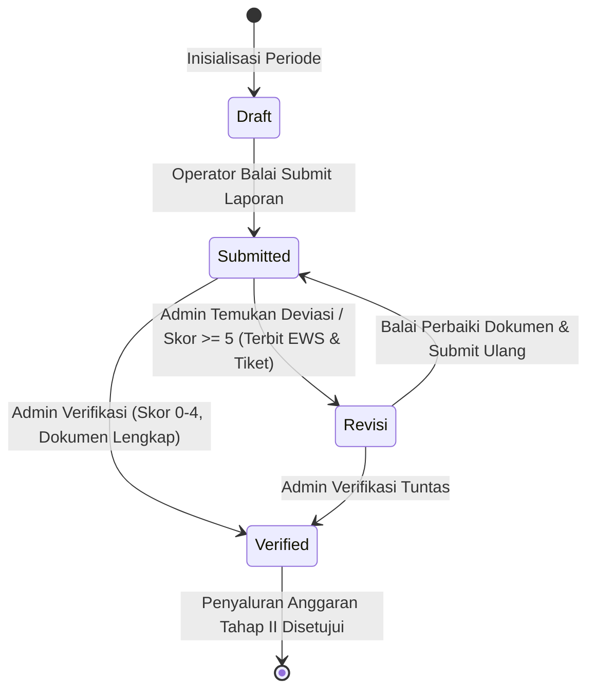

# Dokumentasi Aturan Skoring Risiko dan Early Warning System (EWS)
## Aplikasi SIMADU PELAWAN — DP2KBP3A Kabupaten Bangka

---

### 1. Landasan dan Tujuan

SIMADU PELAWAN (*Sistem Informasi Manajemen Terpadu Pengelolaan Anggaran Balai Penyuluh KB Terintegrasi Early Warning System dan Penilaian Akuntabilitas Berkelanjutan*) menerapkan instrumen evaluasi kinerja berkala berbasis 5 Parameter Kunci ($P_1\text{--}P_5$) untuk menjamin transparansi, ketepatan waktu, dan akuntabilitas serapan anggaran di 8 Balai Penyuluh KB se-Kabupaten Bangka.

Instrumen ini terintegrasi langsung dengan modul **Early Warning System (EWS)** guna memberikan mitigasi dini terhadap risiko deviasi anggaran, keterlambatan pelaporan SPJ, serta mencegah penundaan penyaluran DAK Non-Fisik BOKB Tahap II.

---

### 2. Definisi dan Bobot 5 Parameter Kunci ($P_1\text{--}P_5$)

Setiap parameter memiliki skala skor diskrit dari **0 hingga 3**, di mana skor 0 merepresentasikan kepatuhan penuh dan skor 3 merepresentasikan penyimpangan berat / risiko tinggi.

| Parameter | Nama Parameter | Indikator Utama | Skala Skor & Kriteria Penilaian |
| :--- | :--- | :--- | :--- |
| **$P_1$** | **Ketepatan Waktu Pelaporan** | Deviasi tanggal submit pertama terhadap batas tenggat lapor periode anggaran aktif (`tgl_tenggat_lapor`). | • **0**: Tepat waktu (submit sebelum atau pada tanggal tenggat lapor) • **1**: Terlambat ringan ($\le 2$ hari kalender) • **2**: Terlambat sedang (3–5 hari kalender) • **3**: Terlambat berat ($> 5$ hari kalender atau belum lapor setelah tenggat lewat) |
| **$P_2$** | **Kelengkapan & Keabsahan Dokumen SPJ** | Validitas berkas wajib (LRA, SPTJM, BKU & Kuitansi, Dokumentasi Kegiatan, Rencana Kebutuhan Tahap II). | • **0**: Lengkap dan valid seluruh 5 dokumen wajib • **1**: 1 dokumen berstatus 'kurang' • **2**: $\ge 2$ dokumen berstatus 'kurang' • **3**: Terdapat minimal 1 dokumen berstatus 'tidak valid' ATAU seluruh dokumen belum diunggah (kosong) |
| **$P_3$** | **Deviasi Anggaran & Kesesuaian Rencana** | Selisih/deviasi persentase antara realisasi anggaran terhadap rencana pagu alokasi balai. | • **0**: Realisasi sesuai target pagu (deviasi $< 5\%$) • **1**: Deviasi rendah ($5\% - 10\%$) • **2**: Deviasi sedang ($11\% - 20\%$) • **3**: Deviasi signifikan ($> 20\%$) atau anomali serapan anggaran ekstrim |
| **$P_4$** | **Kepatuhan Regulasi & Standar Biaya Masukan (SBM)** | Kepatuhan terhadap aturan pengelolaan keuangan daerah, perpajakan, dan ketentuan SBM Pemkab Bangka. | • **0**: Patuh penuh tanpa catatan kepatuhan teknis • **1**: Catatan minor terkait perincian kuitansi/bukti pendukung non-material • **2**: Catatan kepatuhan perpajakan atau selisih tarif SBM yang memerlukan revisi • **3**: Temuan berulang, ketidakpatuhan material, atau indikasi pengeluaran di luar juknis |
| **$P_5$** | **Responsivitas & Tindak Lanjut Temuan** | Kecepatan balai dalam menanggapi tiket instruksi perbaikan dan mengunggah bukti koreksi. | • **0**: Menindaklanjuti dan mengunggah bukti koreksi dalam tempo $\le 2$ hari kalender • **1**: Menindaklanjuti dalam rentang 3–5 hari kalender (masih dalam batas tenggat perbaikan) • **2**: Menindaklanjuti setelah batas tenggat perbaikan berakhir (terlambat) • **3**: Mengabaikan instruksi perbaikan / tidak ada respon sampai diekskalasi |

---

### 3. Skala Skor Total dan Kategori Risiko

Total skor dihitung melalui penjumlahan sederhana:
$$\text{Total Skor} = P_1 + P_2 + P_3 + P_4 + P_5$$

Rentang skor teoritis adalah **0 hingga 15**. Klasifikasi kategori risiko didefinisikan sebagai berikut:

| Rentang Skor | Kategori Risiko | Dampak Operasional & Rekomendasi Sistem | Status Default Laporan |
| :---: | :---: | :--- | :---: |
| **0 – 4** | Risiko Rendah | **Kondisi Balai Terkendali.** Pengelolaan anggaran dan berkas SPJ dinilai tertib dan akuntabel. Balai memenuhi syarat rekomendasi penyaluran dana DAK BOKB Tahap II secara tepat waktu. Pemantauan berkala tetap dilakukan. | `Verified` *(Terverifikasi Tuntas)* |
| **5 – 9** | Risiko Sedang | **Perlu Perhatian & Tindak Lanjut.** Terdapat kekurangan dokumen minor, keterlambatan pengiriman, atau deviasi anggaran yang memerlukan perbaikan. Sistem otomatis menerbitkan peringatan dini EWS dan tiket perbaikan untuk Balai. | `Revisi` *(Perlu Perbaikan)* |
| **10 – 15** | Risiko Tinggi | **Berisiko Tinggi / Kritis.** Berpotensi menghambat akuntabilitas dinas dan membekukan penyaluran dana tahap berikutnya. Sistem otomatis menerbitkan peringatan dini level Tinggi/Eskalasi ke Admin Dinas. Diperlukan intervensi dan supervisi langsung ke lokasi balai. | `Revisi` *(Perlu Perbaikan / Eskalasi)* |

---

### 4. Integrasi dengan Early Warning System (EWS)

Modul EWS membagi indikator peringatan dini ke dalam 3 kode spesifik:

1. **`EWS_1` (Peringatan Batas Waktu Pelaporan / Submission Deadline):**
   - **Pemicu:** Dipindai otomatis oleh scheduler `simadu:scan-ews` setiap $H-3$ hari kalender sebelum `tgl_tenggat_lapor` atau jika laporan balai masih berstatus `Draft` / `Revisi` saat tanggal tenggat terlampaui.
   - **Level:** `Sedang` jika $H-3$ s.d $H-0$; `Tinggi` jika telah melewati tenggat.

2. **`EWS_2` (Ketidakabsahan Berkas & Deviasi Anggaran / Document & Budget Deviation):**
   - **Pemicu:** Dipicu saat verifikasi Admin menemukan berkas dokumen berstatus `tidak_valid`, atau skoring $P_2 \ge 2$, $P_3 \ge 2$, atau Total Skor $\ge 5$.
   - **Level:** `Sedang` jika total skor $5\text{--}9$; `Tinggi` jika total skor $\ge 10$.

3. **`EWS_3` (Eskalasi Batas Waktu Tindak Lanjut Terlampaui / Overdue Correction):**
   - **Pemicu:** Tiket perbaikan `TindakLanjutMonitoring` berstatus `Pending` / `In Progress` yang telah melewati `batas_waktu_koreksi` tanpa diselesaikan.
   - **Level:** Otomatis meningkat ke `Tinggi`, status alert beralih ke `Escalated`, dan jumlah pengingat diakumulasikan.

---

### 5. Aturan Perhitungan Waktu dan Hari

- **Satuan Waktu:** Seluruh batas waktu tenggat (`tgl_tenggat_lapor`, `batas_waktu_koreksi`, dan durasi keterlambatan $P_1$) dihitung menggunakan **Hari Kalender** dengan presisi timestamp penuh (`Y-m-d H:i:s`).
- **Batas Waktu Koreksi:** Default batas waktu tindak lanjut adalah **3 hari kalender** sejak diterbitkannya tiket perbaikan (dapat disesuaikan oleh Admin Dinas pada rentang 1–14 hari).
- **Penguncian Tanggal Pengiriman Pertama (`tgl_submit_pertama`):**
  - Dicatat saat Balai pertama kali menekan tombol kirim laporan.
  - Tanggal ini bersifat **permanen (immutable)** dan tidak akan tertimpa saat Balai melakukan perbaikan atau submit ulang pasca-revisi, guna menjamin keadilan penilaian $P_1$.

---

### 6. Perlakuan Dokumen Kosong, Kurang, dan Tidak Valid

1. **Laporan Baru Tanpa Berkas Terunggah (Dokumen Kosong):**
   - Nilai kalkulasi otomatis $P_2 = 3$ (karena seluruh checklist belum dipenuhi).
2. **Dokumen Berstatus 'Kurang':**
   - Jika terdapat 1 dokumen yang belum lengkap: $P_2 = 1$.
   - Jika terdapat $\ge 2$ dokumen yang belum lengkap: $P_2 = 2$.
3. **Dokumen Berstatus 'Tidak Valid':**
   - Jika minimal 1 dokumen berstatus `tidak_valid` (misal: kuitansi fiktif, dokumen salah format, bukti kadaluwarsa): $P_2 = 3$.
4. **Dokumen Lengkap & Valid:**
   - Semua 5 dokumen wajib terunggah dan diverifikasi sah oleh admin: $P_2 = 0$.

---

### 7. Alur Status Laporan & Tiket Tindak Lanjut

#### Aturan Mutlak Tiket Tindak Lanjut:
1. Tiket yang telah berstatus `Verified` dikunci dan **tidak dapat diedit lagi oleh Operator Balai**.
2. Alert EWS **hanya dapat beralih ke `Resolved` jika tiket perbaikan telah diverifikasi tuntas oleh Admin Dinas**.
3. Verifikasi tiket dan skoring risiko **hanya boleh dilakukan oleh Admin Dinas**.
4. Setiap pergantian status mencatat `verified_by` dan `waktu_selesai_verifikasi`.
